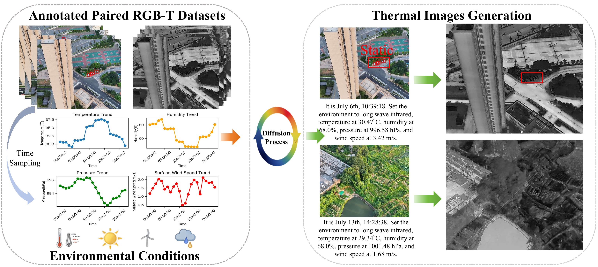

<p align="center">

  <h1 align="center"><a href="https://link.springer.com/chapter/10.1007/978-3-032-37225-3_26" target="_blank">AV2T-Gen: Aerial Visible to Thermal Generation with Environment and Vehicle State Guidance</h1>
  <p align="center">
    <a href="">Kun Yang*</a>,
    <a href="">Yuxiang Liu*</a>,
    <a href="">Yihan Wang</a>,
    <a href="">Shen Yan</a>,
    <a href="">Maojun Zhang</a>,
    <a href="">Yu Liu</a>,
    <a href="">Xue Wang</a>,
    <a href="">Qing Wang</a>
    

  </p>
    <p align="center">
    *Corresponding authors

</p>

## Introduction
Accurate visible-to-thermal image generation holds significant application value in fields such as vehicle detection and autonomous driving. However, existing methods often suffer from the problem that the generated results are inconsistent with environmental conditions and vehicle states  (e.g., moving/static). Moreover, the scarcity of synchronized and calibrated visible-thermal image pairs has further hindered the development of these fields. We propose AV2T-Gen, an innovative environment and vehicle guided visible-to-thermal generation framework built upon the Instruct-Pix2Pix Diffusion Models for aerial imagery, which distinguishes itself from existing methods by explicitly incorporating environment parameters and vehicle state information for the first time. The framework first maps images to the latent space using a VAE to process image features efficiently, and then generates directional features for vehicles in different environmental conditions using multimodal feature information. Meanwhile, we also proposed a visible-thermal paired dataset with environmental conditions and vehicle states. Experimental results have demonstrated that the generated thermal images outperform existing approaches in terms of physical realism and vehicle detail discrimination significantly, with more accurate reflection of environmental and vehicle characteristics.

<p align="center">
  <a href="">
    
  </a>
</p>
<p align="center">
  Our method takes environmental conditions and target motion states as conditions to generate thermal images that both comply with radiometrically plausible and are consistent with the context. Additionally, we propose a novel paired visible-thermal imaging dataset, which is annotated with rich environmental and target metadata.
</p>
<br>

## Dataset
Download the [data](https://drive.google.com/file/) and put it to your dataset folder.

## Citation
If you find this repository useful in your project, please cite the following work:
```
@inproceedings{yang2026av2t,
  title={AV2T-Gen: Aerial Visible to Thermal Generation with Environment and Vehicle State Guidance},
  author={Yang, Kun and Liu, Yuxiang and Wang, Yihan and Yan, Shen and Zhang, Maojun and Liu, Yu and Wang, Xue and Wang, Qing},
  booktitle={European Conference on Computer Vision},
  pages={478--496},
  year={2026},
  organization={Springer}
}
```
